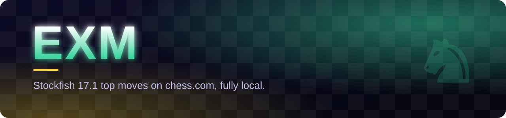

  

  
  
  
  

<h3 align="center">A Chromium extension that reads the chess.com board and shows Stockfish's top 3 moves, locally.</h3>

<b>⭐ Like it? <a href="https://github.com/Vortexyyy/EXM/stargazers">Drop a star</a>. It's free, takes a second, and helps others find it. ⭐</b>

---

Brave/Chromium MV3 extension for chess.com. Reads the board, runs Stockfish 17.1 (full NNUE, single-threaded WASM) locally, and shows the top 3 moves in a draggable panel with arrows drawn on the board.

> **Use it for analysis and learning.** Using engine help in rated or live games against other people breaks chess.com's fair-play rules and can get your account closed. Stick to analysis boards, puzzles, bot games and reviewing your own games.

## Install
1. Go to `brave://extensions` (or `chrome://extensions`) and turn on **Developer mode**.
2. Click **Load unpacked** and pick this folder.
3. Open chess.com and open the analysis board. The panel shows up on the right.

## Controls
- **Toolbar popup**: enable/disable, panel, arrows, only-on-my-turn, depth (8-30).
- **Panel**: drag it by the header. `-` collapses it, `x` hides it, the flip button switches side-to-move if EXM got it wrong.
- **Alt+X**: show/hide the panel.

## How it works
- `content.js` reads the `.piece` elements inside `wc-chess-board`, works out side-to-move from the last-move highlights (with a check-legality fallback), builds a FEN, and watches for changes with a MutationObserver.
- `background.js` starts `offscreen.html`, which runs Stockfish in a Web Worker with `MultiPV 3` and streams lines back as depth increases.
- Everything runs locally. No network calls apart from chess.com itself, no analytics, no accounts.

## License
Stockfish is licensed under the GPL v3 (see `engine/LICENSE-stockfish.txt`), so this project is distributed under the same terms. Not affiliated with chess.com.

If it helps your chess, a star is appreciated.
